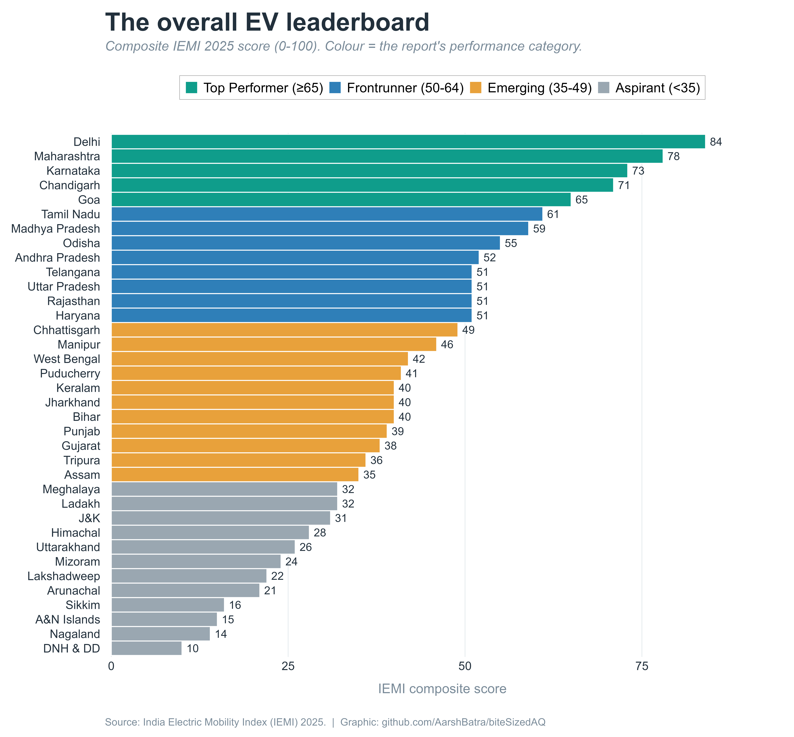
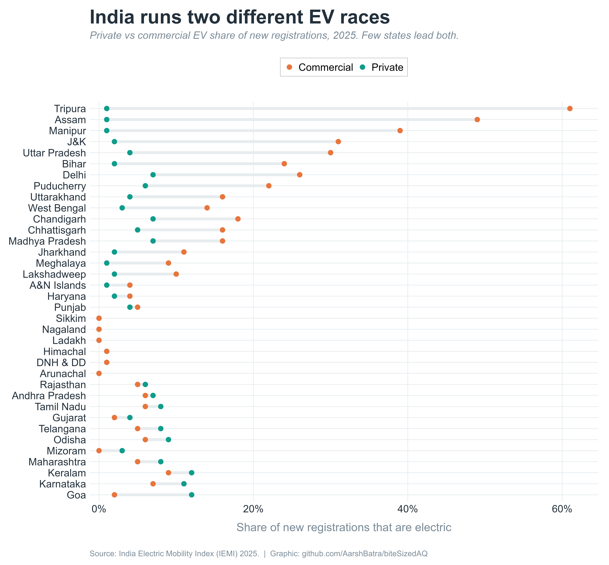
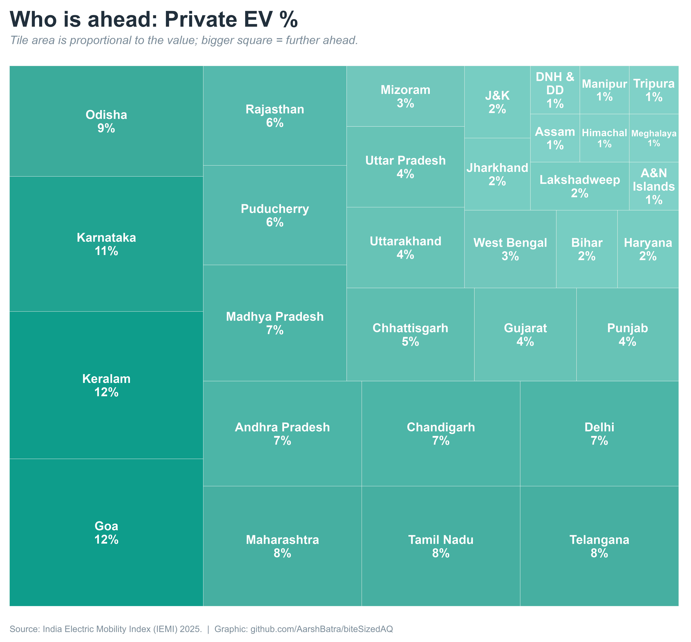
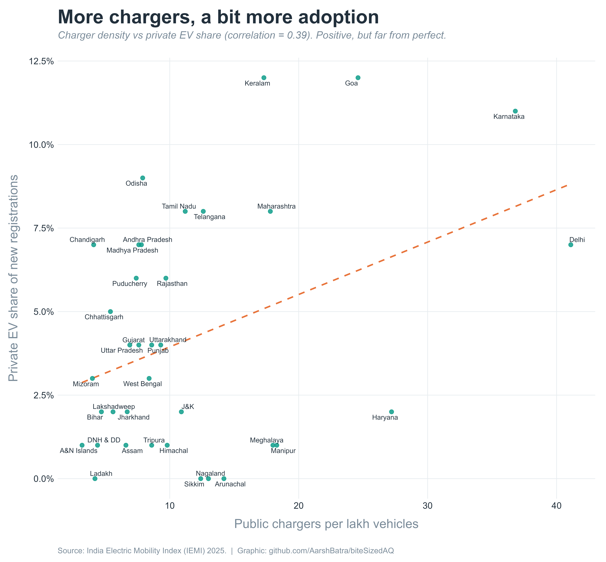
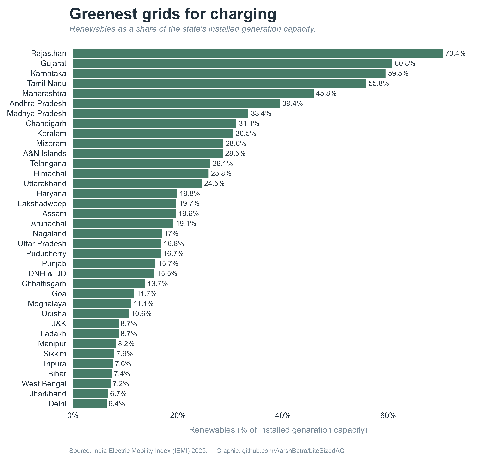

# biteSizedVisual #7: Reading Between the Rankings: India's EV Shift, State by State in 6 Plots

Transport is a growing strain on India's air and climate. Road transport
is responsible for roughly 12% of the country's energy-related
carbon-dioxide emissions and an estimated 18% of its nitrogen-oxide
emissions. The number of vehicles keeps rising too — from about 2 crore
registered in 2020 to 3.1 crore in 2025‑26. There's a cost angle as
well: India imports most of its oil, and road transport accounts for 70%
of the country's diesel use and 99.6% of its petrol. As a result,
Electric vehicles (EVs) are a central part of India's response, and the
government's stated aim is for EVs to make up 30% of new vehicle sales
by 2030 — though it's a big change to manage, since the auto industry
accounts for about 7% of the national gross domestic product, nearly
half of the country's total manufacturing output and supports about 19
million jobs directly or indirectly.

## **What India's EV rankings get right — and what the single score hides.**

## First, a quick primer on EVs

An electric vehicle stores electricity in a battery and uses it to turn
an electric motor, instead of burning petrol or diesel in an engine.
That means an EV has no tailpipe emissions of its own. But the
electricity has to come from somewhere: you plug the vehicle into the
power grid, and the grid is fed by a mix of sources — coal, gas, hydro,
solar and wind. So an EV doesn't erase pollution so much as move it from
the vehicle to the power station. **An EV is only as clean as the
electricity that charges it** — which is why, later on, we look at how
clean each state's power actually is.

Two other things decide how fast EVs catch on: whether people can
conveniently charge them (the *charging network*), and whether they're
cheap enough to buy and run (helped by government *incentives* and by
electricity being cheaper per kilometre than petrol).

## How the IEMI 2025 is built

Much of the EV transition now rests with the states. They layer their
own purchase incentives, charging rules and road-tax waivers on top of
central subsidies — so progress varies widely from one state to the
next. To track that, NITI Aayog and WRI India built the **India Electric
Mobility Index (IEMI)**, which scores all 36 states and union
territories. In this post, I look at its latest 2025 version. It helps
to picture this index as a pyramid with three layers:

-   **At the base, 16 raw measurements** — the real-world numbers for
    each state, like the share of new cars that are electric, public
    chargers per lakh vehicles, or the share of the grid that's
    renewable.

-   **In the middle, three theme scores** — those 16 measurements are
    each rescaled to a 0–100 weighted average score and bundled into
    three themes: **Transport Electrification** (how many EVs are being
    bought), **Charging Infrastructure**, and **EV Research &
    Innovation**.

-   **At the top, one overall score (0–100)** — the three themes are
    combined using fixed weights (Transport Electrification 50%,
    Charging Infrastructure 30%, EV Research & Innovation 20%) into the
    single number that drives the main ranking.

The higher up the pyramid you go (towards the one overall score), the
simpler and easier to compare the number becomes — and the more abstract
(as it's just an index like AQI). The lower we go (towards the 16 raw
measurements), the more intuitive it becomes as we get to see the raw
measurements that make up the score. We'll start at the top, then work
our way down to the raw measurements which helps us understand where the
abstract scores come from.

## The official rankings

The chart below ranks every state and UT by that overall 0–100 score,
with colours marking the four performance groups the report defines (Top
Performer, Frontrunner, Emerging, Aspirant).

| Fig 1 — The overall leaderboard. Each state's combined IEMI 2025 score (0–100).

**Delhi comes first with a score of 84** — the only state above 80.
Behind it are **Maharashtra (78), Karnataka (73), Chandigarh (71) and
Goa (65)**, the five "Top Performers." After them come 8 "Frontrunners,"
11 "Emerging" states and 12 "Aspirants." The typical state (median)
scores just **40**, and the lowest is **10**.

## Where each state's score comes from

Drop down one layer and the ranking gets more interesting. The chart
below breaks every state's overall score into its three theme scores, so
you can see *why* a state sits where it does. Each small panel is one
state (ordered best to worst, overall score in brackets), with a bar for
each theme.

| Fig 2 — The three theme scores behind each rank. For every state: EV Research & Innovation, Charging Infrastructure and Transport Electrification (0–100).

Some states are all-rounders — **Delhi (94, 88, 77)** and **Maharashtra
(85, 91, 68)** are strong on all three. Others lean hard on one leg:
**Haryana** ranks a respectable 10th overall almost entirely on charging
(91) and innovation (74), despite a weak Transport Electrification score
of just 19. **Puducherry** is carried by innovation (66), and
**Karnataka** posts the single best theme score in the country — 97 on
Charging Infrastructure. This middle layer already explains a lot that
the one-overall number ranking can't.

## A note on what these top level scores are — and why I go deeper to the raw ones

It's important to be clear about what an overall score like "84" or "a
charging score of 91" actually is. The IEMI index like any other index
is a unitless number that helps rank and compare states. Think of the
**Air Quality Index** - it takes several separate pollution measurements
and boils them into one easy number and a colour — excellent for a quick
glance and for comparing cities.

The IEMI does the same for the EV sector: it rescales 16 real-world raw
measurements to 0–100, bundles them into three themes, and combines
those into one overall score, by taking a weighted overage over those
themes. That's genuinely useful, and it helps in ranking 36 states at
once in both an overall score and theme wise scores that we saw above,
which already tell us a great deal about the state's performance.

But just as an AQI of 250 tells you less than knowing the air actually
holds 80 micrograms per cubic meter of PM2.5, a charging score of 91
tells you less than knowing a state has, say, 27 public chargers for
every lakh vehicles. The raw numbers are messier to compare across
states — but they're also more concrete, and easier to picture and
understand intuitively.

So for the rest of this piece I go to the bottom layer of the pyramid:
the actual measurements underneath the scores provided by IEMI at the
end of their report in a summarized table. I converted that table from
the report into a clean table and used it for analyses which I will
discuss next.

| *Side note: The report also converts each of the 16 indicators into its own 0–100 score; we don't use those here — I go straight to the raw values.*

None of this is a knock on the index — it's a good quick reference. I
just think the raw data is where the story lives and is easier to
understand intuitively.

## Two EV shifts are happening, not one

The simplest split in the raw data is between **private EVs** — the
electric scooters and cars people buy for themselves — and **commercial
EVs** — electric taxis, delivery vehicles, buses and three-wheelers run
as a business. The chart below shows both for each state: a dot for the
private share (of the total number of private vehicles registered in the
state) and a dot for the commercial share (of the total number of
commercial vehicles registered in the state) of new registrations,
joined by a line. The longer the line, the more lopsided the state.

| Fig 3 — Private vs commercial. For each state, the share of new private vehicles that are electric vs the share of new commercial vehicles. The two leader lists barely overlap.

The private-EV leaders cluster in the south and along the west coast —
**Goa and Kerala (both 12% of new private vehicles are electric) and
Karnataka (11%)** — with **Odisha (9%)** in the east the main exception.
The commercial-EV leaders are a completely different set of states —
**Tripura (61%), Assam (49%), Manipur (39%), Jammu & Kashmir (31%) and
Uttar Pradesh (30%),** with others like Delhi, Bihar, Uttarakhand close
behind them.

And the overall ranking (Fig 1) mostly tracks the private side. **Eight
of the ten best private-EV states also sit in the overall top ten — but
only three of the ten best commercial-EV states do.** So Tripura, the
clear national leader on commercial EVs, sits 23rd overall, and Assam,
second, sits 24th. A sizeable electric shift is under way in these
states, concentrated in commercial vehicles — but it barely registers in
the headline ranking.

## Who's winning on personal EVs

Since the overall score seems to mostly follow private-EV buying, it's
worth looking at who's winning that particular race. In the chart below,
each state is a box sized by its private-EV share — the bigger the box,
the higher the share of new private vehicles that are electric.

| Fig 4 — The private-EV race. States sized by the share of their new private vehicles that are electric.

**Goa and Kerala (12%)** and **Karnataka (11%)** are out front, followed
by a group at 8% — Maharashtra, Tamil Nadu and Telangana. At the other
end, **four states are recorded at 0%** — Arunachal Pradesh, Ladakh,
Nagaland and Sikkim (I assume the report rounds to whole percentages, so
these are likely below 0.5%, not necessarily exactly zero).

But leading one race doesn't guarantee a high overall rank. **Kerala is
tied with Goa for the highest private-EV rate in the country (both 12%),
yet it sits only 18th in the overall ranking.** Its weak spot isn't
charging — it's policy and innovation: in the index, Kerala records no
purchase incentives and no governance measures, and a low
research-and-innovation score. **Goa (5th overall) and Karnataka (3rd)**
pair the same adoption strength with far stronger charging networks —
Karnataka has the best charging-infrastructure score in the country —
and more research activity, and that is what carries them up the table.

## More chargers help — but only a little

Charging infrastructure carries 30% weightage in the overall score, the
second-biggest chunk, so it's worth asking whether more chargers
actually go with more EVs. In the chart below, each state is a dot:
charger availability runs left-to-right, private-EV share runs
bottom-to-top. If chargers were correlated with adoption, the dots would
line up tightly along the dashed line.

| Fig 5 — Chargers vs adoption. Public chargers per lakh vehicles (horizontal) against the private-EV share (vertical). The link is real but loose.

There is some positive correlation, but given this data it's not strong
— the clearest exceptions sit well off the trend. **Delhi has by far the
most chargers, about 41 for every one lakh vehicles, but only 7% of its
new private vehicles are electric; Haryana also has a dense (relative to
Delhi) network yet sits at just 2%.**

Both built out chargers ahead of the buyers. Others go the other way:
**Odisha reaches 9% with a below-average number of chargers, and
Chandigarh hits 7% with one of the smallest networks.** This is part of
why Delhi tops the overall ranking even though its private-EV uptake is
middling — the index credits the charging network it has already put in
place.

When we look at the same plot but for commercial EVs, there seems to be
no correlation.

Note: this plot just shows a correlation, not causation. This is not
meant to imply that more public chargers cause more Private EV
registrations. This simply tells how much they move along together. To
establish causation, other more sophisticated analysis is needed.

## How India compares with the world

One thing the report can’t tell you is how good “best in India” really
is.

A quick caution on units first: the report counts public charging points
per lakh registered vehicles, where “vehicles” means every vehicle
registered in the state over the past 15 years, not just EVs. Delhi’s 41
per lakh works out to roughly 2,439 registered vehicles per charging
point (1,00,000 ÷ 41), and most of those vehicles are not electric. That
is useful for comparing states, but it isn’t how the rest of the world
keeps score.

One thing the report can’t tell you is how good “best in India” really
is. A quick caution on units first: the report counts **public charging
points per lakh registered vehicles**, meaning every vehicle registered
in the state over the past 15 years, not just EVs. Delhi’s 41 per lakh
works out to roughly 2,439 registered vehicles per charging point, and
most of those aren’t electric. The rest of the world keeps score as
**EVs per public charger**. On that measure, Benchmark Mineral
Intelligence’s Q3 2025 data puts the Netherlands at about 5, China at 9,
India at 13 and the US at 31, so India sits mid-pack among leading
markets. ***Treat that with care:*** such tallies depend on what counts
as an EV (cars only, or also two- and three-wheelers) and as a charger
(points or stations). Another 2025 estimate, which doesn’t state its
counting rules, puts India at roughly 235 EVs per charger. But,
irrespective of that it still has a long way to go when compared to
other nations.

The gold standard is **Korea** at about 2.6 EVs per charging point
(2021). In **Netherlands**, at around **5 EVs per charger** — a dense,
demand-driven network built out as drivers request it, where EVs are
already more than half of new car sales. **Norway** is the other
benchmark: over 80% of its new cars are electric, it places fast
chargers at regular intervals along every major road, and crucially its
electricity is almost entirely hydroelectric — so its EVs run on
genuinely clean power.

India's charging network is expanding fast (public chargers roughly
six-folded between 2022 and 2025), but even Delhi's best-in-country
network is modest on the global scale, and the clean-power piece is a
separate challenge again — which brings me to the grid powering the
vehicles.

## Is the electricity even clean?

Remember the primer: an EV is only as clean as the power grid charging
it. So now I look at how much of each state's electricity-generation
capacity is renewable. The chart below ranks states by that renewable
share — the longer the bar, the cleaner the power an EV there is likely
to draw on.

| Fig 6 — How clean is the power? Renewables as a share of each state's installed electricity-generation capacity.

The cleanest grids are in **Rajasthan (70% renewable), Gujarat (61%),
Karnataka (60%) and Tamil Nadu (56%)**. The overall index reflects this
only faintly — which is how **Delhi can top the ranking while having the
least-renewable grid of all, at just over 6%.** Its EVs mostly draw on
fossil-fuel power, so their real climate benefit is smaller than the
sticker suggests. On the brighter side, cleaner grids and higher
private-EV uptake do tend to line up: six of the ten greenest grids are
also among the ten biggest private-EV adopters.

## What's changed since the data

One limit worth keeping in mind: the index is a snapshot of 2025, and
the policy landscape has kept moving in 2026, some of the new updates:

**Jammu & Kashmir** — 27th overall in the index, and recorded in the
index with no EV-governance measures — notified a brand-new EV policy on
30 September 2026, targeting 1.4 lakh EVs by 2032.

**Delhi**, the index leader, has a new EV policy in effect since 1 July
2026 and running to March 2030. It offers a scrappage incentive of up to
₹1 lakh to owners who scrap an old petrol or diesel car and buy a new
electric one (first 1 lakh applicants only), and it plans about 32,000
public chargers, with no deadline reported. It also sets dates after
which only electric vehicles can be newly registered: auto-rickshaws
from 1 January 2027 and two-wheelers from 1 April 2028. Existing
vehicles can keep running.

## Other Concerns not covered in this post or the report

Where the electricity comes from is only part of the story. Batteries
raise the next set of logistical questions. Just putting out EVs on the
road as a replacement for fossil fuels doesn't solve all problems.

It is important to note that making them needs minerals such as lithium,
cobalt and nickel, and mining these has its own environmental and social
costs, costs that are often borne dis proportionally by the marginalized
sections of the society.

Furthermore, when a battery reaches the end of its life, it has to be
reused, recycled or disposed of safely. That needs collection points,
recycling plants, and clear rules on who is responsible for each step.
How well that system keeps up with a fast-growing number of EVs is worth
watching and requires equal weightage in our time. We should not wait
for that to become a problem. The same rigor that goes into promoting
EVs should also go into making sure that down the line when lakhs of
batteries of vehicles sold today need disposing - then we would have the
PROPER infrastructure pre-built and well tested to handle recycling and
reuse.

There are everyday issues too. Home charging is easy for people with
their own parking and harder for people in apartments. Many EVs charging
at once can strain local power networks. Upfront prices are still higher
for many models than for petrol vehicles.

None of this is measured in the IEMI or in this post, and several of
these topics deserve a post of their own.

## Conclusion

EVs are a strong replacement for petrol and diesel, and the IEMI shows
India’s states and territories are in the race, at very different
speeds. But a good ranking is only the start. The bigger infrastructure
needs to keep pace: collecting, recycling and safely disposing of old
batteries, and building chargers where people live and work. The
question to keep asking is which grid is powering the vehicles, clean or
dirty, because that decides how much cleaner an EV really is. A state
can lead on EV sales and still rely on a coal-heavy grid, so the scores,
the raw numbers and the electricity behind them all need to be read
together.

## References

-   [India Electric Mobility Index (IEMI)
    2025](https://www.niti.gov.in/sites/default/files/2026-09/India-Electric-Mobility-Index-IEMI-2025.pdf)
    — NITI Aayog with WRI India (full report PDF). [Landing
    page.](https://www.niti.gov.in/node/2424) All state scores, theme
    scores, ranks and the raw indicator tables come from here.

-   IEA, [Global EV Outlook — Trends in charging
    infrastructure](https://www.iea.org/reports/global-ev-outlook-2022/trends-in-charging-infrastructure),
    and Visual Capitalist, [Countries leading in EV charger
    density](https://www.visualcapitalist.com/ranked-countries-leading-in-ev-charger-density/)
    — for the EU \~10 EVs-per-charger guideline and the Netherlands'
    \~5.

-   Observer Research Foundation, [Charging Infrastructure: The Missing
    Link in India's EV
    Transition](https://www.orfonline.org/research/charging-infrastructure-the-missing-link-in-india-s-evs-transition)
    — for India's \~1 charger per 235 EVs and the 6–20 global benchmark.

-   Swarajya, [J&K notifies EV Policy
    2026](https://swarajyamag.com/news-brief/jammu-and-kashmir-notifies-ev-policy-2026-targets-14-lakh-electric-vehicles-by-2032)
    (30 Sept 2026); AutoPunditz, [Delhi EV Policy
    2026](https://www.autopunditz.com/post/delhi-ev-policy-2026-scrappage-incentive-tax-free-evs)
    — for the recent developments.

***Source note:** India Electric Mobility Index (IEMI) 2025, NITI Aayog
with WRI India (released 16 September 2026; data covers Jan–Dec 2025).
Overall scores and theme scores are from the report's summary tables;
the state-by-state comparisons of the raw indicators are biteSizedAQ's
own analysis. International and 2026 figures are from the references
above. Graphics above:
[github.com/AarshBatra/biteSizedAQ](https://github.com/AarshBatra/biteSizedAQ).*

## Support This Work: Give It a Star

Thank you for reading! If you found this project helpful or interesting,
please consider starring it on GitHub. Your stars help others discover
and benefit from this fully open and free repository. Click [here to
star the
repository](https://github.com/AarshBatra/biteSizedAQ/stargazers) and
join other folks who follow biteSizedAQ.

## License and Reuse {#license-and-reuse}

All original content on biteSizedAQ (text, code and graphic designs
created by me) is shared under the Creative Commons Attribution 4.0
International (CC BY 4.0) license, with the exception of the third-party
data noted below. You are welcome to use this material in your reports
or news stories. Please give appropriate credit and include a link back
to the original work.

**Third-party data.** The graphics and analysis in this post draw on the
*India Electric Mobility Index (IEMI) 2025*, prepared by WRI India in
partnership with NITI Aayog. The report, and the data and scores in it,
belong to their authors and are not covered by this license. The
graphics are shared under CC BY 4.0 as visual designs, but the IEMI data
they display remains the property of its authors. If you reuse a
graphic, keep the source line in the caption. If you want the underlying
numbers or plan anything beyond quoting or illustrating, please go to
the [original
report](https://www.niti.gov.in/sites/default/files/2026-09/India-Electric-Mobility-Index-IEMI-2025.pdf)
and follow the terms set by NITI Aayog and WRI India. This post is
independent analysis and is not an official statement by either
organisation.

Every effort is made to ensure that only original or appropriately
licensed material is shared. If any content has been included in error,
please let me know and I will address it promptly.

Thank you for respecting these terms!

## Get in touch {data-link="Get in touch"}

Get in touch about related topics/report any errors. Reach out to me at
bitesizedaq\@gmail.com.
